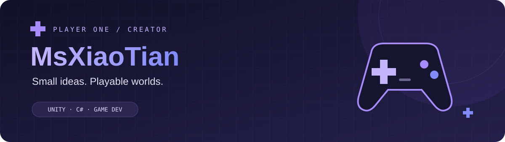
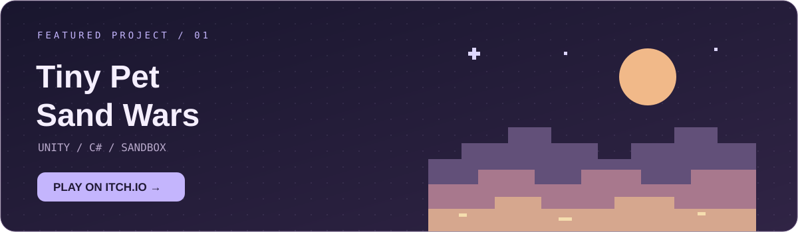

<p align="center">
  <picture>
    <source media="(prefers-color-scheme: light)" srcset="./assets/banner-light.svg" />
    
  </picture>
</p>

<h1 align="center">Hi, I'm 萌神小天 👋</h1>

<p align="center">
  <strong>用 Unity 和 C#，把脑海中的小世界变成可以玩的游戏。</strong>
</p>

<p align="center">
  🎓 郑州轻工业大学 &nbsp; · &nbsp; 🎮 Game Developer &nbsp; · &nbsp; 💜 Unity &amp; C#
</p>

<p align="center">
  <a href="https://msxiaotian.itch.io/tiny-pet-sand-wars"></a>
  <a href="https://www.taptap.cn/user/683054906/works"></a>
  <a href="https://github.com/MsXiaoTian-Gamer?tab=repositories"></a>
  <a href="mailto:MsXiaoTian@icloud.com"></a>
</p>

<p align="center">
  <a href="#games">🎮 游戏作品</a> &nbsp; / &nbsp;
  <a href="#about">👾 关于我</a> &nbsp; / &nbsp;
  <a href="#toolkit">🛠️ 开发工具</a> &nbsp; / &nbsp;
  <a href="#connect">🌱 找到我</a>
</p>

<a name="games"></a>

## 🎮 01 / 游戏作品

<a href="https://msxiaotian.itch.io/tiny-pet-sand-wars">
  <picture>
    <source media="(prefers-color-scheme: light)" srcset="./assets/game-card-light.svg" />
    
  </picture>
</a>

> 一只小宠物，一片沙盒世界，一场趣味对战冒险。

使用 **Unity + C#** 打造，把关于游戏的小想法，一点点变成真实的互动体验。

[**🎮 试玩 Tiny Pet Sand Wars →**](https://msxiaotian.itch.io/tiny-pet-sand-wars) &nbsp; · &nbsp; [**🕹️ 浏览我的 TapTap 作品 →**](https://www.taptap.cn/user/683054906/works)

<a name="about"></a>

## 👾 02 / 关于我

```csharp
public class MsXiaoTian
{
    public string Name   => "萌神小天";
    public string School => "郑州轻工业大学";
    public string Engine => "Unity";
    public string Code   => "C#";

    public string Motto  => "Make games. Have fun. Share with the world.";
}
```

<a name="toolkit"></a>

## 🛠️ 03 / 开发工具

**游戏与创作** <sub> / GAME DEVELOPMENT</sub>

<p>
  
  
  
  
</p>

**编码与协作** <sub> / CODE &amp; WORKFLOW</sub>

<p>
  
  
  
</p>

<a name="connect"></a>

## 🌱 04 / 找到我

除了成品游戏，这里也记录着我的代码与创作。

| 平台 | 传送门 |
| :--- | :--- |
| 🎮 **itch.io** | [玩玩我做的游戏 →](https://msxiaotian.itch.io) |
| 🕹️ **TapTap** | [探索我的作品 →](https://www.taptap.cn/user/683054906/works) |
| 📦 **GitHub** | [浏览项目与代码 →](https://github.com/MsXiaoTian-Gamer?tab=repositories) |
| ⭐ **Stars** | [发现让我获得灵感的项目 →](https://github.com/MsXiaoTian-Gamer?tab=stars) |
| ✉️ **Email** | [MsXiaoTian@icloud.com](mailto:MsXiaoTian@icloud.com) |

---

<p align="center">
  <strong>Make games. Have fun. Share with the world.</strong><br />
  <sub>感谢来访，愿我们都能做出自己喜欢的游戏。 ✨</sub>
</p>

<p align="center">
  <picture>
    <source media="(prefers-color-scheme: light)" srcset="./assets/footer-light.svg" />
    
  </picture>
</p>
